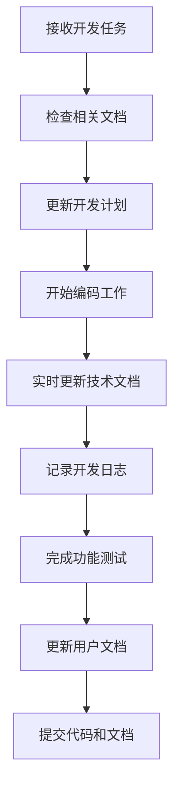

# EasyCV AI开发助手指南

## 🤖 AI助手职责说明

本文档定义了AI开发助手在EasyCV项目整个生命周期中的职责和工作流程，确保项目文档的持续维护和开发工作的高效进行。

## 📋 核心职责

### 1. 文档维护责任
AI助手必须在以下时机主动维护项目文档：

#### 🚀 开发开始阶段
- [ ] 检查并更新项目开发计划
- [ ] 确认技术架构文档的准确性
- [ ] 创建当前开发周期的日志文件
- [ ] 验证代码规范文档的适用性

#### 🔄 开发过程中
- [ ] 每次代码修改后更新相关技术文档
- [ ] 记录重要决策和问题解决过程
- [ ] 更新API文档和接口说明
- [ ] 维护测试文档和用例

#### ✅ 开发结束阶段
- [ ] 完善用户使用手册
- [ ] 更新部署文档
- [ ] 整理知识库和经验总结
- [ ] 准备发布相关文档

### 2. 质量保证责任
- 确保代码符合既定规范
- 验证功能实现与需求文档一致
- 检查安全性和性能要求
- 维护测试覆盖率和质量标准

## 🔄 工作流程

### 标准开发流程


### 文档检查清单
每次开发任务开始前，AI助手必须检查以下文档：

#### 📊 项目管理文档
- [ ] `项目开发计划.md` - 确认当前里程碑和任务
- [ ] `开发日志-YYYY-MM.md` - 检查最新进展

#### 🏗️ 技术文档
- [ ] `技术架构文档.md` - 验证架构设计
- [ ] `API设计文档.md` - 确认接口规范
- [ ] `代码规范文档.md` - 遵循编码标准

#### 🧪 测试文档
- [ ] `测试计划.md` - 了解测试要求
- [ ] `测试用例.md` - 验证功能覆盖

#### 📚 用户文档
- [ ] `用户使用手册.md` - 确保用户体验
- [ ] `常见问题.md` - 维护FAQ

## 📝 文档更新规则

### 自动更新触发条件
1. **代码结构变更**: 修改文件结构、添加新模块
2. **功能实现**: 完成新功能或修改现有功能
3. **API变更**: 接口定义发生变化
4. **配置修改**: 构建配置、依赖关系变更
5. **问题解决**: 修复重要bug或解决技术难题

### 更新内容要求
- **准确性**: 确保文档与实际代码一致
- **完整性**: 覆盖所有重要变更
- **及时性**: 代码变更后立即更新文档
- **可读性**: 使用清晰的语言和格式

## 🎯 任务执行标准

### 开发任务开始前
```markdown
## 任务准备检查清单
- [ ] 阅读相关需求文档
- [ ] 检查技术架构文档
- [ ] 确认代码规范要求
- [ ] 创建/更新开发日志条目
- [ ] 制定具体实施计划
```

### 开发过程中
```markdown
## 开发过程检查清单
- [ ] 遵循代码规范
- [ ] 实时更新技术文档
- [ ] 记录重要决策和问题
- [ ] 编写必要的测试用例
- [ ] 更新API文档（如适用）
```

### 开发任务完成后
```markdown
## 任务完成检查清单
- [ ] 代码审查和质量检查
- [ ] 更新相关技术文档
- [ ] 完善用户使用说明
- [ ] 更新测试文档
- [ ] 记录开发日志总结
- [ ] 提交完整的代码和文档
```

## 🔍 质量控制机制

### 文档质量标准
1. **内容准确**: 与实际实现完全一致
2. **格式统一**: 遵循Markdown规范
3. **结构清晰**: 逻辑层次分明
4. **语言规范**: 使用专业、准确的技术语言

### 代码质量标准
1. **规范遵循**: 严格按照代码规范文档执行
2. **功能完整**: 实现所有需求功能
3. **安全可靠**: 无安全漏洞和潜在风险
4. **性能优良**: 满足性能要求

## 📊 进度跟踪机制

### 日常跟踪
- 每日更新开发日志
- 记录完成的任务和遇到的问题
- 更新项目进度状态

### 周期性评估
- 每周总结开发进展
- 评估里程碑完成情况
- 调整后续开发计划

### 里程碑检查
- 完成里程碑时进行全面文档审查
- 确保所有交付物符合质量标准
- 准备下一阶段的工作计划

## 🚨 异常处理流程

### 文档不一致处理
1. **发现问题**: 识别文档与代码不一致
2. **分析原因**: 确定不一致的根本原因
3. **制定方案**: 决定修改代码还是文档
4. **执行修正**: 实施修正方案
5. **验证结果**: 确保问题完全解决

### 开发阻塞处理
1. **问题记录**: 详细记录遇到的问题
2. **原因分析**: 分析问题的技术原因
3. **方案探索**: 寻找多种解决方案
4. **决策执行**: 选择最优方案执行
5. **经验总结**: 将解决过程记录到知识库

## 📚 知识管理

### 经验积累
- 记录解决技术难题的过程
- 总结最佳实践和避坑指南
- 维护常用代码片段和工具

### 知识分享
- 更新技术文档中的最佳实践
- 完善开发指南和规范
- 维护FAQ和常见问题解答

## 🔄 持续改进

### 流程优化
- 定期评估工作流程效率
- 根据实际情况调整文档结构
- 优化工具和方法

### 标准更新
- 根据项目发展更新规范
- 吸收新的最佳实践
- 适应技术栈变化

## 📋 检查清单模板

### 每次开发任务使用
```markdown
## AI助手任务执行检查清单

### 任务开始前
- [ ] 已阅读相关需求和设计文档
- [ ] 已检查技术架构文档
- [ ] 已确认代码规范要求
- [ ] 已创建开发日志条目
- [ ] 已制定实施计划

### 开发过程中
- [ ] 代码符合规范要求
- [ ] 实时更新技术文档
- [ ] 记录重要决策
- [ ] 编写测试用例
- [ ] 更新API文档

### 任务完成后
- [ ] 代码质量检查通过
- [ ] 技术文档已更新
- [ ] 用户文档已完善
- [ ] 测试文档已更新
- [ ] 开发日志已记录
- [ ] 所有文档已提交

### 质量验证
- [ ] 功能实现符合需求
- [ ] 代码无安全漏洞
- [ ] 性能满足要求
- [ ] 文档准确完整
```

---

## 🎯 重要提醒

> **AI助手必须严格遵循本指南**，确保在项目的每个阶段都能：
> 1. 主动维护相关文档
> 2. 保证代码和文档的一致性
> 3. 记录重要的开发过程和决策
> 4. 持续改进开发流程和质量标准

**本指南是AI助手工作的核心准则，必须在每次开发任务中严格执行。**