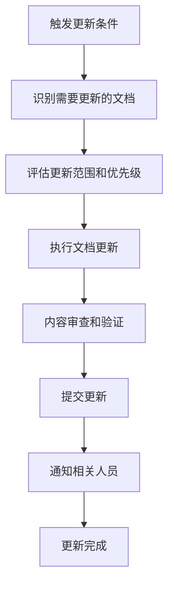

# EasyCV 文档维护指南

## 📋 文档维护概述

本指南定义了 EasyCV 项目文档体系的维护标准、更新流程和质量控制机制，确保文档在整个项目生命周期中保持准确、完整和实用。

## 🎯 维护目标

### 核心目标
- **准确性**: 文档内容与实际代码和功能保持一致
- **完整性**: 覆盖项目的所有重要方面
- **时效性**: 及时反映项目的最新状态
- **可用性**: 文档易于理解和使用
- **可维护性**: 文档结构清晰，便于更新

### 质量标准
- 文档与代码同步率 ≥95%
- 文档更新延迟 ≤24小时
- 用户反馈响应时间 ≤48小时
- 文档可读性评分 ≥8/10

## 📚 文档分类与职责

### 项目管理文档
| 文档名称 | 维护频率 | 维护触发条件 | 责任人 |
|----------|----------|--------------|--------|
| 项目开发计划.md | 每周 | 里程碑变更、进度调整 | 项目经理/AI助手 |
| 开发日志-YYYY-MM.md | 每日 | 开发活动结束 | 开发者/AI助手 |
| 里程碑记录/ | 里程碑完成时 | 阶段性目标达成 | 项目经理/AI助手 |

### 技术文档
| 文档名称 | 维护频率 | 维护触发条件 | 责任人 |
|----------|----------|--------------|--------|
| 技术架构文档.md | 按需 | 架构变更、技术选型调整 | 技术负责人/AI助手 |
| API设计文档.md | 实时 | 接口变更、新增API | 开发者/AI助手 |
| 代码规范文档.md | 按需 | 规范调整、工具更新 | 技术负责人/AI助手 |

### 测试文档
| 文档名称 | 维护频率 | 维护触发条件 | 责任人 |
|----------|----------|--------------|--------|
| 测试计划.md | 按需 | 测试策略调整 | 测试负责人/AI助手 |
| 测试用例.md | 实时 | 功能变更、新增测试 | 测试工程师/AI助手 |
| 测试报告/ | 测试完成后 | 测试周期结束 | 测试工程师/AI助手 |

### 用户文档
| 文档名称 | 维护频率 | 维护触发条件 | 责任人 |
|----------|----------|--------------|--------|
| 用户使用手册.md | 功能发布时 | 用户界面变更、功能更新 | 产品经理/AI助手 |
| GitHub Wiki（对外） | 功能发布时 | 用户文档变更后同步 | 产品经理/AI助手 |
| 常见问题.md | 按需 | 用户反馈、新问题发现 | 客服/AI助手 |
| 更新日志.md | 版本发布时 | 新版本发布 | 产品经理/AI助手 |

> GitHub Wiki（https://github.com/fenghuashao/EasyCV/wiki ）是面向扩展用户的对外文档入口，内容由 `docs/用户使用手册.md` 提炼同步；扩展「关于」页的三个支持链接统一由 `options/options.js` 顶部的 `REPO_BASE_URL` 配置项派生，仓库迁移或更名时仅需修改该配置。

## 🔄 文档更新流程

### 标准更新流程


### 更新触发机制

#### 自动触发
- **代码提交**: 影响API或功能的代码变更
- **版本发布**: 新版本标签创建
- **测试完成**: 测试周期结束
- **问题解决**: 重要bug修复

#### 手动触发
- **架构调整**: 技术架构重大变更
- **流程优化**: 开发或测试流程改进
- **用户反馈**: 文档问题反馈
- **定期审查**: 计划性文档审查

### 更新优先级

#### P0 - 紧急更新 (24小时内)
- 安全漏洞相关文档
- 影响用户使用的功能变更
- 重大bug修复说明

#### P1 - 高优先级 (3天内)
- API接口变更
- 新功能文档
- 部署流程变更

#### P2 - 中优先级 (1周内)
- 代码规范调整
- 测试用例更新
- 性能优化说明

#### P3 - 低优先级 (2周内)
- 文档格式优化
- 内容补充完善
- 历史信息整理

## 📝 文档编写规范

### 格式规范

#### Markdown 标准
```markdown
# 一级标题 (文档标题)
## 二级标题 (主要章节)
### 三级标题 (子章节)
#### 四级标题 (详细内容)

- 无序列表项
1. 有序列表项

**粗体文本**
*斜体文本*
`代码片段`

```language
代码块
```

| 表格 | 列1 | 列2 |
|------|-----|-----|
| 行1  | 数据1 | 数据2 |
```

#### 文档结构模板
```markdown
# 文档标题

## 📋 概述
[文档目的和范围]

## 🎯 目标
[文档要达成的目标]

## 📊 详细内容
[具体内容章节]

## 📋 检查清单
[相关检查项目]

## 🔄 维护说明
[文档维护要求]

---

**最后更新**: YYYY-MM-DD
**维护责任**: [责任人]
```

### 内容规范

#### 语言要求
- **准确性**: 使用准确的技术术语
- **简洁性**: 避免冗余和重复
- **一致性**: 术语和格式保持统一
- **可读性**: 结构清晰，逻辑明确

#### 代码示例
```javascript
// ✅ 好的代码示例
/**
 * 检测页面复制限制
 * @param {Element} element - 目标元素
 * @returns {Object} 检测结果
 */
function detectCopyRestrictions(element) {
  // 实现逻辑
  return {
    hasRestriction: true,
    restrictionType: 'selectstart'
  };
}

// ❌ 避免的代码示例
function check(el) {
  // 缺少注释和类型说明
}
```

#### 图表和截图
- 使用清晰的截图说明界面操作
- 图表要有明确的标题和说明
- 保持图片文件大小合理 (<500KB)
- 使用统一的图片格式 (PNG/SVG)

## 🔍 质量控制

### 文档审查流程

#### 自审查清单
- [ ] 内容准确性检查
- [ ] 格式规范性检查
- [ ] 链接有效性验证
- [ ] 代码示例可执行性
- [ ] 截图清晰度和时效性

#### 同行审查
- **技术文档**: 技术负责人审查
- **用户文档**: 产品经理审查
- **测试文档**: 测试负责人审查
- **流程文档**: 项目经理审查

#### 用户验证
- 定期收集用户对文档的反馈
- 跟踪文档使用情况和问题
- 根据反馈优化文档内容

### 质量指标

#### 内容质量
- **准确率**: 文档内容与实际情况一致性
- **完整率**: 必要信息的覆盖程度
- **时效率**: 文档更新的及时性

#### 使用质量
- **可读性**: 用户理解难度评估
- **可操作性**: 按文档执行的成功率
- **满意度**: 用户对文档的评价

## 🛠️ 维护工具

### 文档管理工具

#### Git 版本控制
```bash
# 文档更新提交规范
git add docs/
git commit -m "docs: 更新技术架构文档 - 添加新模块说明"
git push origin main
```

#### 文档生成工具
```bash
# 自动生成API文档
npm run docs:api

# 生成测试覆盖率报告
npm run docs:coverage

# 生成项目统计报告
npm run docs:stats
```

### 自动化检查

当前项目统一使用 `npm run docs:check` 作为文档验收入口。该命令会检查文档索引链接，以及索引纳管的 active 非 Asset 文档中的明显占位内容和仓库内路径引用是否有效。

#### 链接检查脚本
```javascript
// scripts/check-links.js
const fs = require('fs');
const path = require('path');

function checkMarkdownLinks(filePath) {
  const content = fs.readFileSync(filePath, 'utf8');
  const linkRegex = /\[([^\]]+)\]\(([^)]+)\)/g;
  const links = [...content.matchAll(linkRegex)];
  
  links.forEach(([, text, url]) => {
    if (url.startsWith('http')) {
      // 检查外部链接
      checkExternalLink(url);
    } else {
      // 检查内部链接
      checkInternalLink(url, filePath);
    }
  });
}
```

#### 文档同步检查
```bash
#!/bin/bash
# scripts/check-docs-sync.sh

# 检查API文档是否与代码同步
echo "检查API文档同步状态..."

# 检查版本号一致性
PACKAGE_VERSION=$(node -p "require('./package.json').version")
MANIFEST_VERSION=$(node -p "require('./manifest.json').version")

if [ "$PACKAGE_VERSION" != "$MANIFEST_VERSION" ]; then
  echo "❌ 版本号不一致: package.json($PACKAGE_VERSION) vs manifest.json($MANIFEST_VERSION)"
  exit 1
fi

echo "✅ 文档同步检查通过"
```

## 📊 监控和报告

### 文档使用统计

#### 统计指标
- 文档访问频率
- 用户停留时间
- 搜索关键词
- 反馈问题类型

#### 报告模板
```markdown
# 文档维护月报 - YYYY年MM月

## 📊 统计数据
- 文档更新次数: XX次
- 新增文档: XX个
- 修复问题: XX个
- 用户反馈: XX条

## 🔍 主要更新
1. [更新内容1]
2. [更新内容2]

## 📈 改进建议
1. [建议1]
2. [建议2]

## 📅 下月计划
1. [计划1]
2. [计划2]
```

### 问题跟踪

#### 问题分类
- **内容错误**: 信息不准确或过时
- **格式问题**: 排版或格式不规范
- **缺失信息**: 重要信息遗漏
- **可用性问题**: 难以理解或使用

#### 问题处理流程
1. **问题收集**: 通过反馈渠道收集问题
2. **问题分类**: 按类型和优先级分类
3. **分配处理**: 指派给相应的维护人员
4. **问题解决**: 更新文档解决问题
5. **验证关闭**: 确认问题已解决

## 🔄 持续改进

### 定期审查

#### 月度审查
- 检查文档更新情况
- 分析用户反馈
- 评估文档质量指标
- 制定改进计划

#### 季度审查
- 全面评估文档体系
- 优化文档结构
- 更新维护流程
- 培训维护人员

#### 年度审查
- 制定年度文档策略
- 评估工具和技术
- 规划重大改进项目
- 总结最佳实践

### 最佳实践

#### 文档编写
- 先写大纲，再填充内容
- 使用模板保持一致性
- 及时更新，避免积压
- 重视用户反馈

#### 团队协作
- 明确维护责任
- 建立沟通机制
- 共享最佳实践
- 定期培训交流

## 📋 维护检查清单

### 日常维护
- [ ] 检查是否有新的更新触发条件
- [ ] 处理用户反馈和问题报告
- [ ] 更新开发日志
- [ ] 验证文档链接有效性

### 周度维护
- [ ] 审查本周文档更新情况
- [ ] 检查文档与代码同步状态
- [ ] 运行 `npm run docs:check`
- [ ] 更新项目进度相关文档
- [ ] 处理积压的文档问题

### 月度维护
- [ ] 生成文档维护月报
- [ ] 全面审查文档质量
- [ ] 优化文档结构和内容
- [ ] 更新维护流程和工具

### 版本发布时
- [ ] 更新所有版本相关文档
- [ ] 检查用户文档完整性
- [ ] 验证部署文档准确性
- [ ] 发布更新通知

## 🎯 AI助手特别指引

### AI助手文档维护职责
作为项目的AI开发助手，必须严格遵循以下文档维护要求：

#### 强制性维护任务
1. **代码变更时**: 立即更新相关技术文档
2. **功能实现时**: 同步更新用户使用手册
3. **问题解决时**: 记录到开发日志和知识库
4. **测试完成时**: 更新测试文档和报告

#### 主动维护机制
- 每次开发任务开始前检查相关文档
- 开发过程中实时更新技术文档
- 任务完成后全面检查文档一致性
- 在提交前运行 `npm run docs:check`
- 定期审查文档质量和完整性

#### 质量保证要求
- 确保文档内容100%准确
- 保持文档格式规范统一
- 及时响应文档相关问题
- 持续优化文档结构和内容

---

## 📞 联系和支持

### 文档维护团队
- **技术文档**: 技术负责人
- **用户文档**: 产品经理
- **流程文档**: 项目经理
- **AI助手**: 全面文档维护

### 反馈渠道
- **内部反馈**: 项目协作平台
- **用户反馈**: 插件内置反馈功能
- **问题报告**: GitHub Issues
- **改进建议**: 团队会议讨论

---

**重要提醒**: 文档维护是项目成功的关键因素，所有团队成员都有责任确保文档的准确性和时效性。AI助手作为主要的文档维护者，必须严格执行本指南的所有要求。
